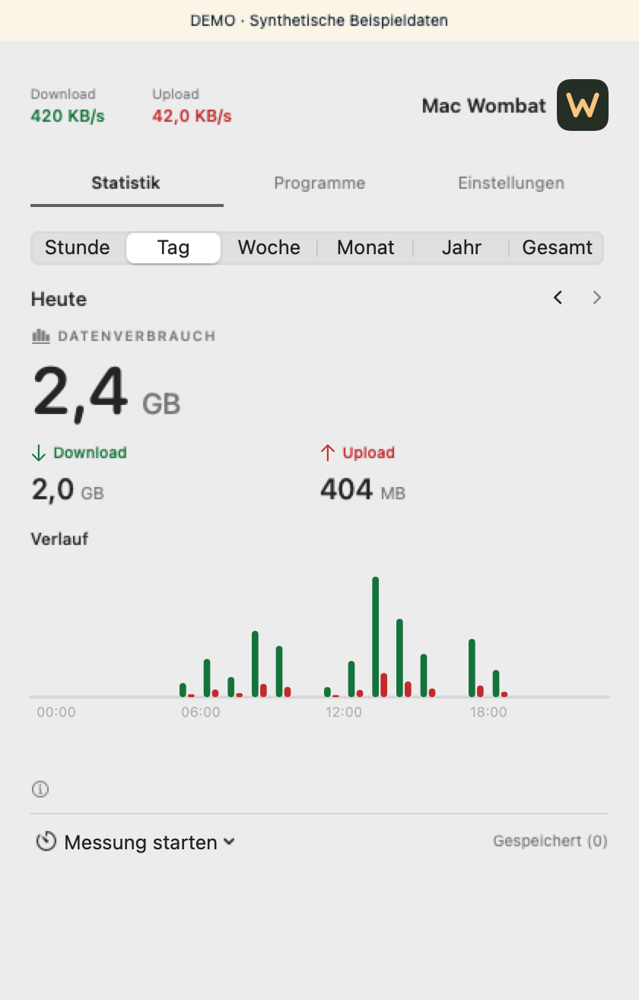

# Mac Wombat

Sieh die aktuellen Download- und Uploadraten deines Macs in der Menüleiste und schau nach, wann dein Mac Daten übertragen hat. Die native Swift-App speichert die Historie lokal in SQLite und unterstützt benannte Messungen und den CSV-Export.

[English](README.md) · [Projektwebsite](https://mac-wombat.pages.dev/) · [Fahrplan](ROADMAP.md) · [Aufgaben und Fehlerberichte](https://github.com/arnefranz-del/mac-wombat/issues)



*Native App-Ansicht mit synthetischen Beispieldaten.*

## Funktionen

- Live-Raten in drei Menüleistengrößen im Blick behalten.
- Die erfasste Historie nach Stunde, Tag, Woche, Monat, Jahr oder über den gesamten Zeitraum ansehen. Unbeobachtete Zeit bleibt als Lücke sichtbar.
- Messungen mit Timer oder manuell starten und unter einem Namen speichern. Die reguläre Minutenhistorie lässt sich in den Einstellungen als CSV exportieren.
- Im Tab **Programme** eine begrenzte Momentaufnahme des Programmverkehrs ansehen.

Mac Wombat liest die Zähler aktiver WLAN- und Ethernet-Schnittstellen. Die Summen können lokalen Verkehr und VPN-Transport enthalten. Sie zeigen zeitliche Muster und sind für Abrechnungen ungeeignet. Die App speichert die Historie lokal und arbeitet ohne Konto, Telemetrie oder Cloud-Synchronisierung. [Messgrenzen](Documentation/Public/ARCHITECTURE.md#deutsch) · [Datenschutz](PRIVACY.md#deutsch)

## Lokal bauen

Mac Wombat ist als **Quellvorschau unter MIT-Lizenz** verfügbar. Die App ist für macOS 14 oder neuer ausgelegt. Zum Bauen benötigst du Apples Swift-6-Werkzeuge und Python 3 für das App-Paket. Das Swift-Paket hat keine externen Abhängigkeiten.

```sh
xcrun swift --version
python3 --version
git clone https://github.com/arnefranz-del/mac-wombat.git
cd mac-wombat
./Scripts/test.sh
./Scripts/build.sh
```

Die lokal ad hoc signierte App liegt unter `build/products.noindex/Wombat.app`. Ohne vorhandene Installation kannst du das gebaute Paket direkt öffnen. Wenn Wombat schon installiert ist, nutze vor dem Wechsel die [Anleitung für Updates und Rollback](Documentation/Public/INSTALLATION.md#deutsch).

| Umgebung | Geprüft |
| --- | --- |
| Intel-Mac, macOS 14.7 | Lokaler Build und vollständige automatisierte Suite, einschließlich nativer Bitmap-Tests. |
| GitHub-Runner, macOS 15 auf Intel und Apple Silicon | Build und automatisierte Tests auf beiden Architekturen in [Lauf 43214835228](https://github.com/arnefranz-del/mac-wombat/actions/runs/43214835228). Auf dem gehosteten Intel-Runner werden vier Bitmap-Tests übersprungen. |
| Physischer Mac mit Apple Silicon | Interaktive Bedienung, Ruhezustand und Aufwachen, Anmeldung, Update und Rollback stehen zur Prüfung aus. |

## Mitmachen

Die [Beitragsregeln](CONTRIBUTING.md) beschreiben, welche Angaben in einem Fehlerbericht helfen. Melde reproduzierbare Fehler und Vorschläge in den [GitHub-Issues](https://github.com/arnefranz-del/mac-wombat/issues). Sicherheitsbefunde gehören in den [vertraulichen Meldeweg](SECURITY.md). Der [Fahrplan](ROADMAP.md) zeigt die nächsten Aufgaben.

[MIT-Lizenz](LICENSE) · [Bild- und Schriftnachweise](Documentation/Public/LICENSING.md) · [Website-Quellen und lokale Vorschau](Documentation/Public/WEBSITE.md)
