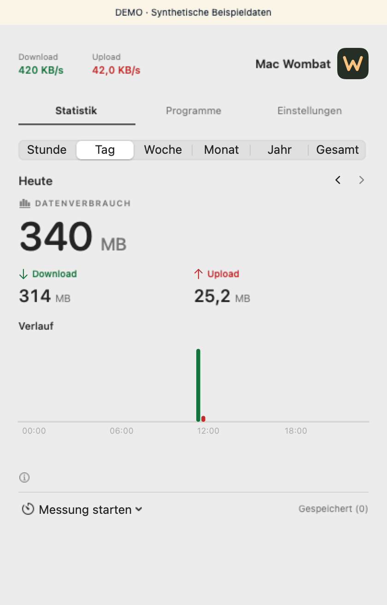

# Mac Wombat

Mac Wombat zeigt die aktuellen Download- und Uploadraten deines Mac in der Menüleiste. Die native Swift-App liest die Zähler aktiver WLAN- und Ethernet-Schnittstellen und speichert die beobachteten Zeitabschnitte lokal.

[English](README.md) · [Website-Quellen](Website/) · [Fahrplan](ROADMAP.md) · [Aufgaben und Fehlerberichte](https://github.com/arnefranz-del/mac-wombat/issues)

## Funktionen

- Live-Raten in der Menüleiste, mit drei Anzeigegrößen.
- Verbrauchsverlauf für Stunde, Tag, Woche, Monat, Jahr und den gesamten erfassten Zeitraum.
- Manuelle oder zeitlich begrenzte Messungen, gespeicherte Ergebnisse und CSV-Export.
- Begrenzte Momentaufnahme des Programmverkehrs über macOS `nettop`.

Die Historie bleibt auf deinem Mac. Die App hat kein Konto, keine Telemetrie und keine Synchronisierung. Schlaf und nicht erfasste Zeit bleiben als Lücken sichtbar. Lokaler Verkehr und VPN-Transport auf physischen Schnittstellen können mitgezählt werden. Programmwerte sind eine Momentaufnahme. [Datenschutz](PRIVACY.md) · [Messgrenzen](Documentation/Public/ARCHITECTURE.md)



## Lokal bauen

Für den lokalen Build der **Quellvorschau** brauchst du macOS 14 oder neuer, Apples Swift-6-Werkzeuge und Python 3 für das Paket. SwiftPM lädt keine externen Abhängigkeiten.

```sh
git clone https://github.com/arnefranz-del/mac-wombat.git
cd mac-wombat
./Scripts/test.sh
./Scripts/build.sh
```

Die lokal ad hoc signierte App liegt unter `build/products.noindex/Wombat.app`. Vor dem Austausch einer bestehenden App die [Installations- und Update-Anleitung](Documentation/Public/INSTALLATION.md) lesen. Intel wurde unter macOS 14.7 getestet. Die native Laufzeitprüfung dieses Quellstands auf Apple Silicon steht aus.

## Mitmachen

Fehler und Ideen gehören in die [GitHub-Issues](https://github.com/arnefranz-del/mac-wombat/issues). Die [Beitragsregeln](CONTRIBUTING.md) erklären, welche Angaben helfen. Sicherheitsbefunde bitte über den [vertraulichen Meldeweg](SECURITY.md) schicken.

[MIT-Lizenz](LICENSE) · [Bildnachweise](Documentation/Public/LICENSING.md)
