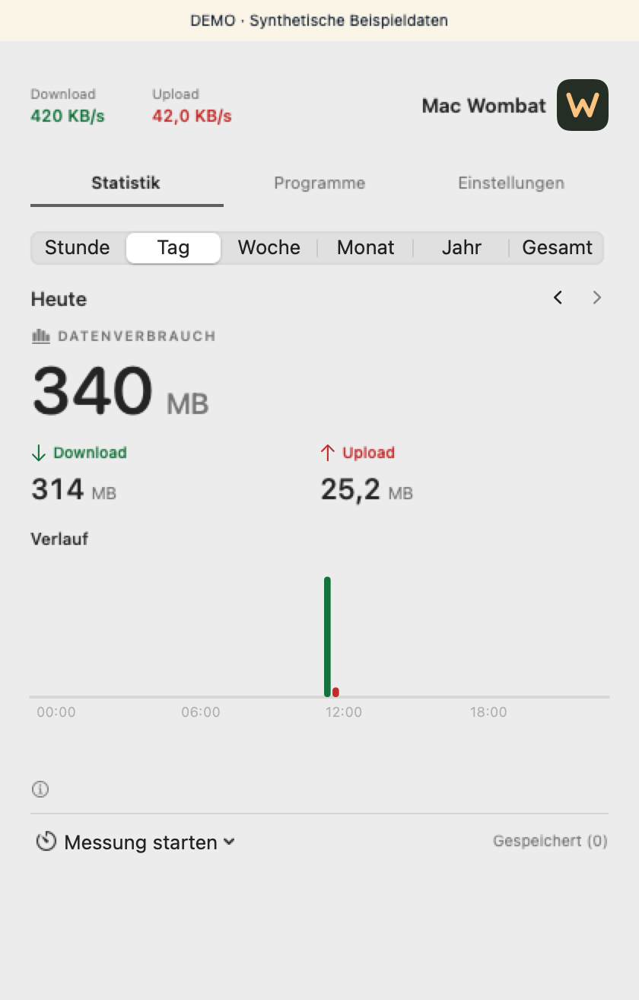

# Mac Wombat

Mac Wombat is a native macOS menu bar app for live network rates and local data usage history. It reads the counters of active Wi-Fi and Ethernet interfaces and records the intervals it observes.

[Deutsch](README.de.md) · [Website source](Website/) · [Roadmap](ROADMAP.md) · [Issues](https://github.com/arnefranz-del/mac-wombat/issues)

## What it does

- See current download and upload rates in the menu bar.
- Browse recorded usage by hour, day, week, month, year or all time.
- Start a timed or manual measurement, save it and export your usage history as CSV.
- View a limited application-traffic snapshot while the Programme tab is open.

History stays on your Mac. There is no Wombat account, telemetry or sync. Sleep and other unobserved intervals appear as gaps. Totals include local traffic and can include VPN transport on the underlying physical interface. Per-app figures are a snapshot and do not add up to a complete per-app history. [Privacy and storage](PRIVACY.md) · [How measurements work](Documentation/Public/ARCHITECTURE.md)



The screenshot uses synthetic data. The app UI is currently in German. Home Wombat, the separate router-monitoring experiment, is outside this repository's scope.

## Build locally

This is a **source preview**. A signed public download is planned. You'll need macOS 14 or newer, Apple's Swift 6 tools and Python 3 for packaging. The Swift package has no external dependencies.

```sh
git clone https://github.com/arnefranz-del/mac-wombat.git
cd mac-wombat
./Scripts/test.sh
./Scripts/build.sh
```

Find the locally ad hoc-signed app at `build/products.noindex/Wombat.app`. See the [installation and update guide](Documentation/Public/INSTALLATION.md) before replacing an existing copy. Intel has been tested on macOS 14.7. Native Apple Silicon runtime validation for this public snapshot is still open.

## Contribute

Start with [CONTRIBUTING.md](CONTRIBUTING.md). Use [issues](https://github.com/arnefranz-del/mac-wombat/issues) for bugs and feature proposals. Use [private vulnerability reporting](SECURITY.md) for security findings.

The project is distributed under the [MIT License](LICENSE). See the [asset credits](Documentation/Public/LICENSING.md).
