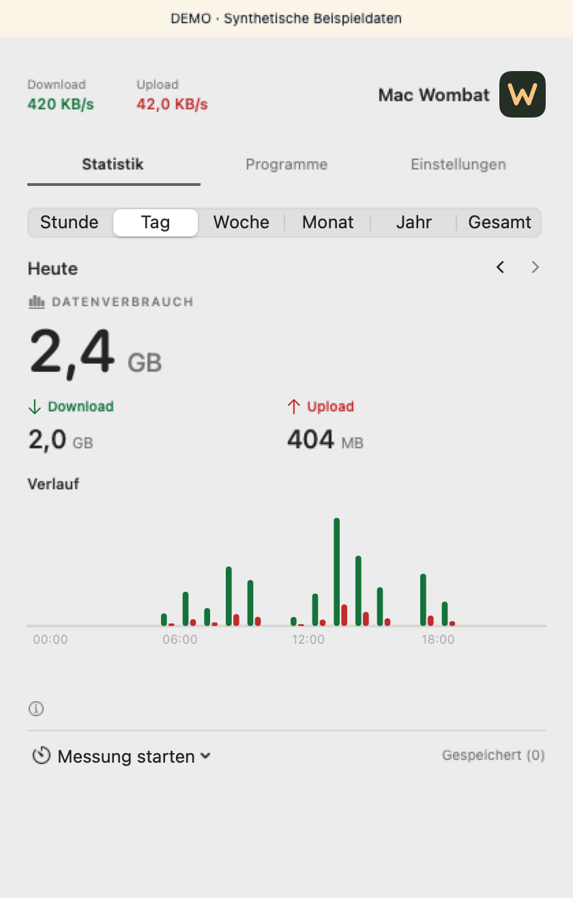

# Mac Wombat

See your Mac’s current download and upload rates in the menu bar and look back at the traffic it recorded. Mac Wombat is a native Swift app with local SQLite history, named measurements, and CSV export.

[Deutsch](README.de.md) · [Project website](https://mac-wombat.pages.dev/en/) · [Roadmap](ROADMAP.md) · [Issues](https://github.com/arnefranz-del/mac-wombat/issues)



*Native app view with synthetic sample data. The app UI is currently in German.*

## What it does

- Keep live rates in view with three menu bar layouts.
- Browse recorded usage by hour, day, week, month, year, or all recorded time. Gaps show when Wombat did not observe traffic.
- Start a timed or manual measurement and save the result under a name. Export the regular minute history as CSV from Settings.
- View a limited snapshot of application traffic in the **Programme** tab.

Mac Wombat reads counters on active Wi-Fi and Ethernet interfaces. The totals can include local traffic and VPN transport carried on those interfaces. Use them to investigate patterns. Billing requires a different source. The app stores usage locally and works without an account, telemetry, or cloud sync. [Measurement details](Documentation/Public/ARCHITECTURE.md) · [Privacy and storage](PRIVACY.md)

## Build locally

Mac Wombat is available as an **MIT-licensed source preview**. The app targets macOS 14 or later. You need an Apple toolchain with Swift 6 and Python 3 for packaging. The Swift package has no external dependencies.

```sh
xcrun swift --version
python3 --version
git clone https://github.com/arnefranz-del/mac-wombat.git
cd mac-wombat
./Scripts/test.sh
./Scripts/build.sh
```

The build produces a locally ad hoc-signed app at `build/products.noindex/Wombat.app`. For a first run, open that bundle directly. If Wombat is already installed, use the [local update and rollback guide](Documentation/Public/INSTALLATION.md) before switching builds.

| Where | What has been checked |
| --- | --- |
| Intel Mac, macOS 14.7 | Local build and full automated suite, including native bitmap tests. |
| GitHub-hosted macOS 15, Intel and Apple Silicon | Build and automated tests on both architectures in [run 43214835228](https://github.com/arnefranz-del/mac-wombat/actions/runs/43214835228). Hosted Intel skips four native bitmap tests. |
| Physical Apple Silicon Mac | Interactive use, sleep/wake, login, updates, and rollback remain open. |

See the [compatibility notes](Documentation/Public/INSTALLATION.md#compatibility) for toolchain requirements and CI history.

## Contribute

Start with the [contribution guide](CONTRIBUTING.md). Share reproducible bugs and proposals in [GitHub Issues](https://github.com/arnefranz-del/mac-wombat/issues). Use [private vulnerability reporting](SECURITY.md) for security findings. See the [roadmap](ROADMAP.md) for test and contributor priorities.

[MIT license](LICENSE) · [Asset credits](Documentation/Public/LICENSING.md) · [Website source and preview](Documentation/Public/WEBSITE.md)
